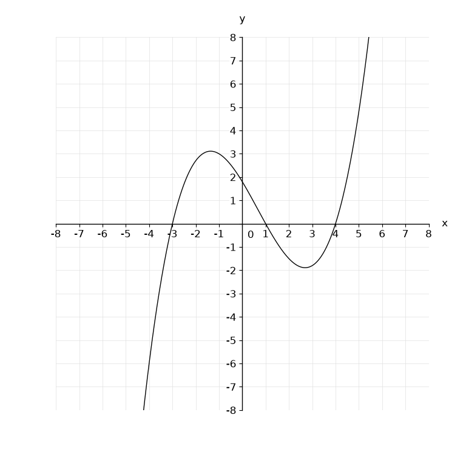
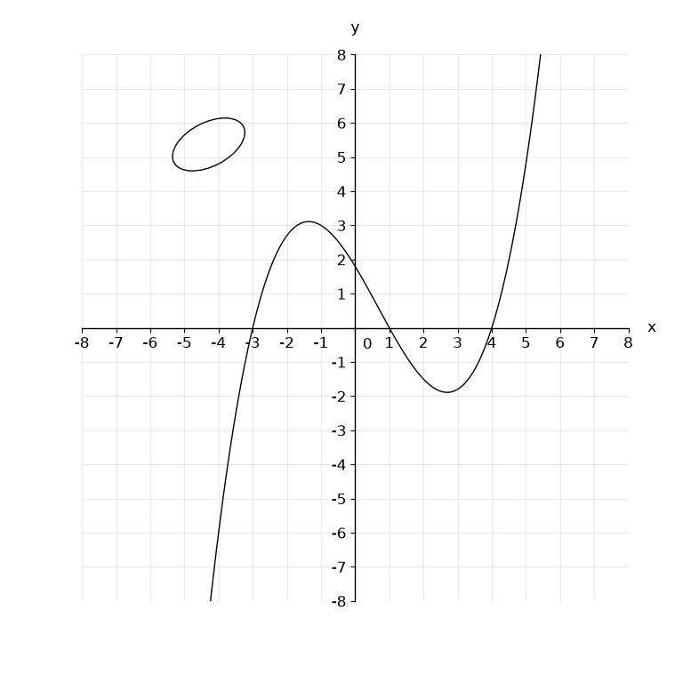
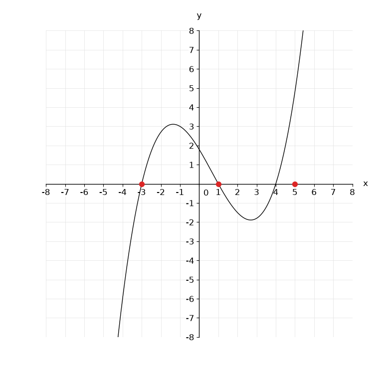

# MathPalette: Controlled Visual Math Robustness Evaluation

**Research question:** Which visual distractions disrupt mathematical reasoning, even in strong closed-source VLMs, when rendering is standardized?

## 1. Motivation

- **Uncontrolled rendering complicates attribution.** Differences in resolution, fonts, line styles, and diagram conventions make it difficult to isolate what causes model errors.
- **Effective distractions for strong models remain a question to investigate.** We aim to test whether deliberately designed visual misdirection is more effective than ordinary visual perturbations.

Project branches: [Analytics](Analytics/README.md) for functions and analytic geometry, [PlaneGeometry](PlaneGeometry/REDRAW_PROTOCOL.md) for plane diagram redraws, and [SolidGeometry](SolidGeometry/REDRAW_PROTOCOL.md) for solid diagram redraws with frozen 3D geometry, projection, and visibility.

## 2. Dataset Construction

| Stage | Construction | Purpose |
| --- | --- | --- |
| **Original** | Format existing problems and redraw them under a unified rendering protocol. | Establish a controlled baseline. |
| **Base variants** | Automatically apply one task-irrelevant perturbation per variant. | Test robustness to ordinary visual changes. |
| **Adversarial variants** | Manually design and annotate distractions targeting key points, relations, or visual attention. | Test susceptibility to deliberate visual misdirection. |

The Analytics branch uses six Base operations: change the grid, hide tick labels, change the background, or add a random dashed line, shape, or isolated points.

All variants derive independently from the original. Keep the question and answer unchanged, review semantic validity and readability, and save operations for reproducibility.

### Example: True Roots or Misleading Markers?

**Ana14:** The cubic polynomial $f(x)$ has three real roots $x_1, x_2, x_3$. What is $x_1+x_2+x_3$? **Correct answer: 2.**

|                          Original                           |                                            Base variant                                            |                                     Adversarial variant                                     |
| :---------------------------------------------------------: | :------------------------------------------------------------------------------------------------: | :-----------------------------------------------------------------------------------------: |
|  |  |  |
|          The curve crosses the x-axis at $-3,1,4$.          |                            Add an irrelevant ellipse in the upper left.                            |          Add red dots at $x=-3,1,5$ on the x-axis, suggesting a false root at $5$.          |
|                         Sum: **2**                          |                                             Sum: **2**                                             |                     True sum: **2**; following the markers gives **3**.                     |

The intended misdirection is to read the red markers as roots instead of checking the curve's actual intersections; its effect must be verified experimentally.

## 3. Target Scale

**200 plane geometry + 200 analytic geometry + 200 solid geometry problems.**

Each problem: **1 original + 6 Base variants + approximately 4 adversarial variants.**

**600 x 11 = approximately 6,600 image-question pairs.**

Current collection: 127 original problems (66 Analytics, 40 PlaneGeometry, 21 SolidGeometry), including 107 newly redrawn MathVerse questions. Analytics samples four of the six Base operations per problem; geometry Base / Special workflows remain pending. Six variants per problem is the expansion target. Source answers are retained, with separate verification findings; see the [source/redraw review](imports/mathverse_vision_dominant/redraw_review.html) and [issue list](imports/mathverse_vision_dominant/issues.md). Existing evaluation scores below refer only to the original 20-question prototype.

## 4. Expected Results

**Hypothesis: Original accuracy $\approx$ Base accuracy $>$ Adversarial accuracy.**

Evaluate open- and closed-source VLMs under matched settings. Report overall accuracy, the proportion of originally correct answers that become incorrect, and whether errors match the intended misdirection. Aggregate by original problem for fair comparisons.

## 5. Preliminary Results

Completed runs as of October 9, 2026. Original accuracy uses **20 problems x 3 trials**; adversarial accuracy uses **72 manually created variants x 1 trial**.

| Model                | Original (base) accuracy | Adversarial accuracy | Drop (pp) |
| -------------------- | -----------------------: | -------------------: | --------: |
| MiMo-v2.6-Flash      |                   88.33% |               70.83% |     17.50 |
| Qwen3.5-9B           |                   91.67% |               62.50% |     29.17 |
| Qwen3-VL-8B-Instruct |                   73.33% |               48.61% |     24.72 |
| Qwen3-VL-8B-Thinking |                   71.67% |               44.44% |     27.22 |

Only completed scores are shown: Qwen3.5-4B adversarial evaluation is incomplete, and no original run was found for MiMo-v2.5. Automated **Base variant** results are not yet available; `base` in the saved run filenames refers to original problems.

Source: [evaluation traces and reports](Analytics/val_script/), with accuracies verified against trial-level judgments. These are the scripts' existing averages, not reweighted by original problem. MiMo-v2.6-Flash judges all listed runs except MiMo-v2.5, which judges itself; numeric answers allow 10% relative tolerance (zero uses an absolute tolerance of 1e-8).

## 6. Potential Contributions

1. **A standardized visual math benchmark** supporting controlled evaluation, ablations, and future robustness fine-tuning.
2. **A manually annotated adversarial set** distinguishing deliberate misdirection from ordinary perturbations, with broad evaluation including strong closed-source models.
3. **An analysis of shared failure patterns** across models and problem types, informing strategies to improve visual robustness.
4. **Reproducible interventions and paired diagnostics** enabling individual distractions to be replayed or removed to investigate their effects.
