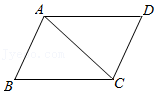
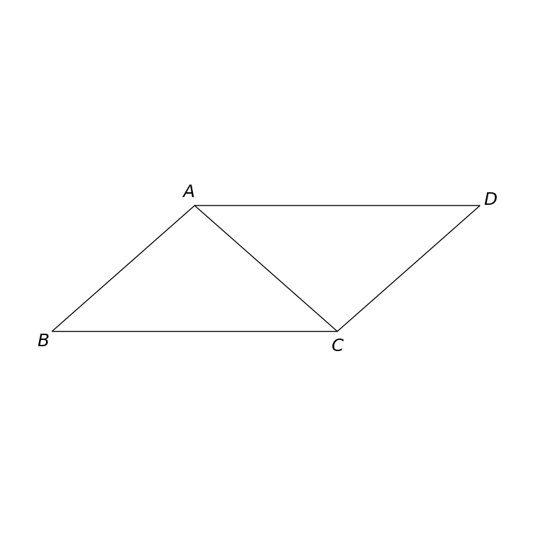

# MathVista 179 · 平面几何

[返回总目录](../../README.md) · [上一题 178](../178/README.md) · [下一题 186](../186/README.md)

状态：**待用户审核（改编题）**。尚未收入正式题库。

## 当前待审核题目

如图，在平行四边形ABCD中，已知AC＝4cm，若△ACD的周长为14cm，则平行四边形ABCD的周长为（）

选项：A. 14cm；B. 28cm；C. 10cm；D. 20cm

当前答案：20cm

## 原图与重绘

| 原图 | 协议重绘 |
|---|---|
|  |  |

点击图片可放大。

## 原题记录

来源：MathVista testmini / GeoQA+

原题：如图，在ABCD中，已知AC＝4cm，若△ACD的周长为14cm，则ABCD的周长为（）

原官方答案：20cm

## 改编说明

- {"before": "在ABCD中", "after": "在平行四边形ABCD中", "reason": "补明原题缺失的平行四边形条件。"}
- {"before": "则ABCD的周长", "after": "则平行四边形ABCD的周长", "reason": "在求解目标中保持图形名称完整一致。"}

若ABCD仅为任意四边形，△ACD周长不能确定整个四边形周长。补明图示平行四边形后，可由对边相等唯一确定周长，不修改长度、选项或冻结图形。

[完整改编记录、解题与独立检查](adapted_question.json)

## 文件与反馈

[冻结场景](scene.json) · [重绘脚本](redraw.py) · [核验报告](redraw_report.json)

[完整来源记录](source_metadata.json)

可在草稿 PR 的 Conversation 留言“MathVista 179：通过 / 需要修改，具体是……”，也可以直接告诉 dot。改编题请明确是否接受改编。点赞或 GitHub 的通用 Approve 不自动代替逐题通过记录。

[来源与许可](../../ATTRIBUTION.md)
