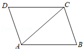
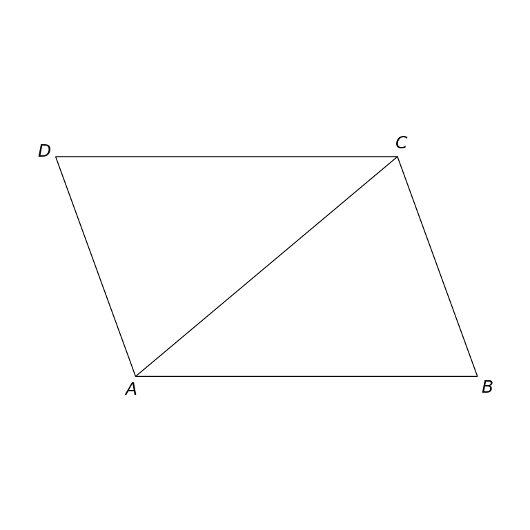

# MathVista 32 · 平面几何

[返回总目录](../../README.md) · [上一题 30](../30/README.md) · [下一题 33](../../special/33/README.md)

状态：**待用户审核（改编题）**。尚未收入正式题库。

## 当前待审核题目

如图，在平行四边形ABCD中，AB＝AC，∠CAB＝40°，则∠D的度数是（）

选项：A. 40°；B. 50°；C. 60°；D. 70°

当前答案：70°

## 原图与重绘

| 原图 | 协议重绘 |
|---|---|
|  |  |

点击图片可放大。

## 原题记录

来源：MathVista testmini / GeoQA+

原题：如图，在ABCD中，AB＝AC，∠CAB＝40°，则∠D的度数是（）

原官方答案：70°

## 改编说明

- {"before": "在ABCD中", "after": "在平行四边形ABCD中", "reason": "补明原题缺失的平行四边形条件；与原图、冻结场景及题目所需关系一致。"}

原文字仅写ABCD，无法从AB＝AC和∠CAB＝40°单独确定顶点D的角。补上平行四边形条件后题目唯一可解，不修改数字、选项或图形。

[完整改编记录、解题与独立检查](adapted_question.json)

## 文件与反馈

[冻结场景](scene.json) · [重绘脚本](redraw.py) · [核验报告](redraw_report.json)

[完整来源记录](source_metadata.json)

可在草稿 PR 的 Conversation 留言“MathVista 32：通过 / 需要修改，具体是……”，也可以直接告诉 dot。改编题请明确是否接受改编。点赞或 GitHub 的通用 Approve 不自动代替逐题通过记录。

[来源与许可](../../ATTRIBUTION.md)
