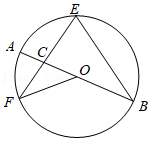
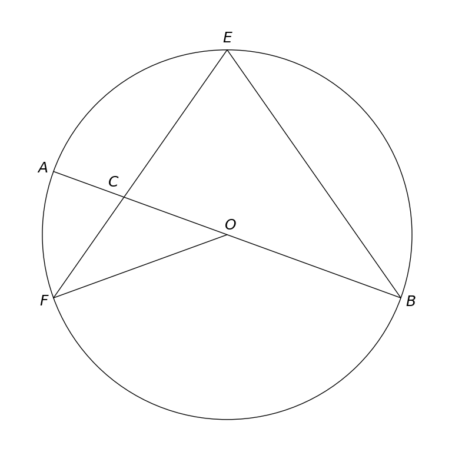

# MathVista 35 · 平面几何

[返回总目录](../../README.md) · [上一题 33](../../special/33/README.md) · [下一题 48](../48/README.md)

状态：**待用户审核（改编题）**。尚未收入正式题库。

## 当前待审核题目

如图，AB是⊙O的直径，EF，EB是⊙O的弦，点E是优弧FB的中点，EF与AB交于点C，连接OF，若∠AOF＝40°，则∠EFO的度数是（）

选项：A. 20°；B. 35°；C. 40°；D. 55°

当前答案：35°

## 原图与重绘

| 原图 | 协议重绘 |
|---|---|
|  |  |

点击图片可放大。

## 原题记录

来源：MathVista testmini / GeoQA+

原题：如图，AB是⊙O的直径，EF，EB是⊙O的弦，点E是FEB的中点，EF与AB交于点C，连接OF，若∠AOF＝40°，则∠F的度数是（）

原官方答案：35°

## 改编说明

- {"before": "点E是FEB的中点", "after": "点E是优弧FB的中点", "reason": "恢复丢失的圆弧语义，并明确E位于图示优弧FB的中点，排除线段中点和劣弧中点的歧义。"}
- {"before": "则∠F的度数", "after": "则∠EFO的度数", "reason": "用三点角名明确图中F处由FE、FO两条射线形成的待求角，不增加条件。"}

原文字FEB没有弧符号，含义不完整。明确图示优弧中点及角的两条射线后，与原圆、直径、弦和半径完全一致；所有数值和选项保留。

[完整改编记录、解题与独立检查](adapted_question.json)

## 文件与反馈

[冻结场景](scene.json) · [重绘脚本](redraw.py) · [核验报告](redraw_report.json)

[完整来源记录](source_metadata.json)

可在草稿 PR 的 Conversation 留言“MathVista 35：通过 / 需要修改，具体是……”，也可以直接告诉 dot。改编题请明确是否接受改编。点赞或 GitHub 的通用 Approve 不自动代替逐题通过记录。

[来源与许可](../../ATTRIBUTION.md)
