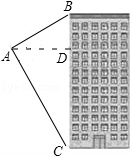
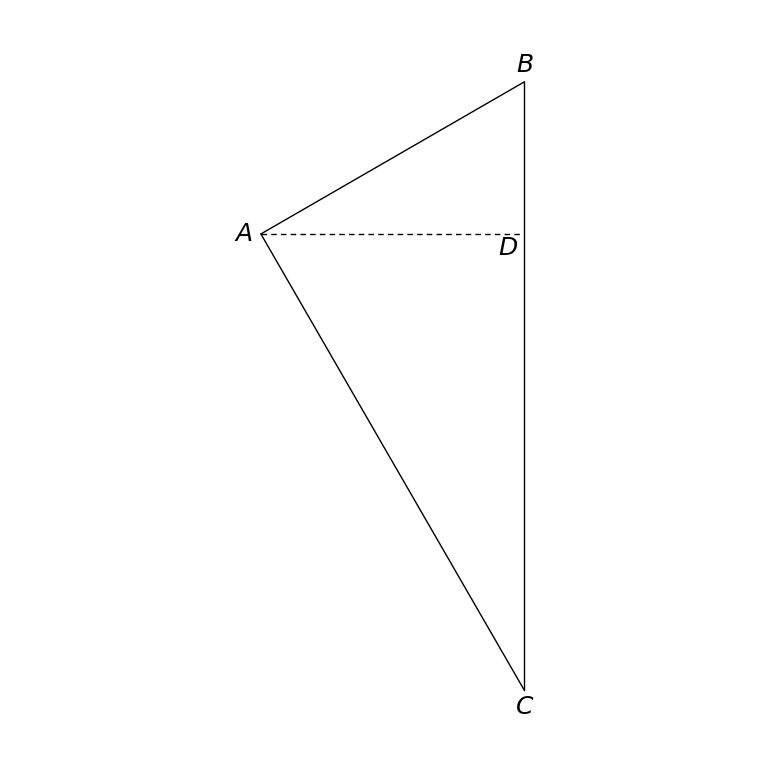

# MathVista 269 · 平面几何

[返回总目录](../../README.md) · [上一题 257](../../batch1/257/README.md) · [下一题 270](../270/README.md)

状态：**待用户审核**。尚未收入正式题库。

## 当前待审核题目

As shown in the figure, the elevation angle of the top of a building is 30.0 when viewed from point A in the air by a hot air balloon, and the depression angle of this building is 60.0. The horizontal distance between the hot air balloon and the building is 120.0. The height of this building is ()

选项：A. 160m；B. 160√{3}m；C. (160-160√{3})m；D. 360m

当前答案：160√{3}m

## 原图与重绘

| 原图 | 协议重绘 |
|---|---|
|  |  |

点击图片可放大。

## 原题记录

来源：MathVista testmini / UniGeo

原题：As shown in the figure, the elevation angle of the top of a building is 30.0 when viewed from point A in the air by a hot air balloon, and the depression angle of this building is 60.0. The horizontal distance between the hot air balloon and the building is 120.0. The height of this building is ()

原官方答案：160√{3}m

## 注意事项

- Building facade is illustrative decoration and omitted. The tiny source arrows along AD do not carry separate geometry. No numerical angle or length labels occur in the original diagram.

## 文件与反馈

[冻结场景](scene.json) · [重绘脚本](redraw.py) · [核验报告](redraw_report.json)

[完整来源记录](source_metadata.json)

可在草稿 PR 的 Conversation 留言“MathVista 269：通过 / 需要修改，具体是……”，也可以直接告诉 dot。改编题请明确是否接受改编。点赞或 GitHub 的通用 Approve 不自动代替逐题通过记录。

[来源与许可](../../ATTRIBUTION.md)
