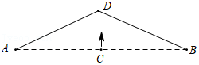
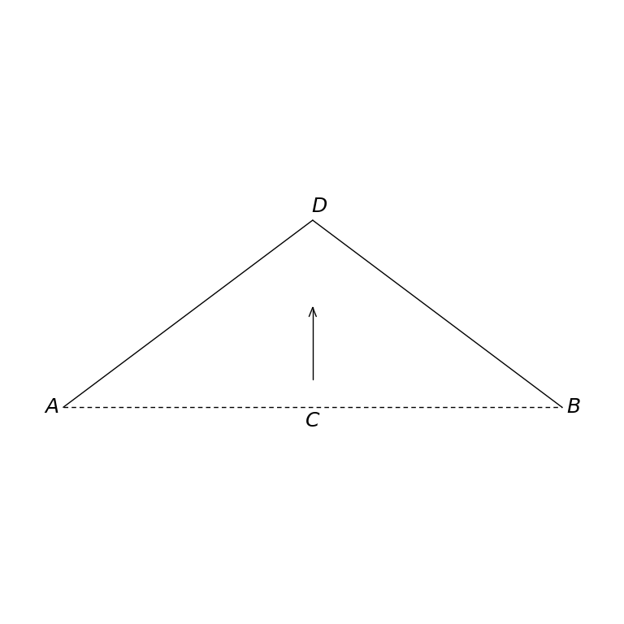

# MathVista 286 · 平面几何

[返回总目录](../../README.md) · [上一题 285](../285/README.md) · [下一题 290](../290/README.md)

状态：**待用户审核**。尚未收入正式题库。

## 当前待审核题目

如图，将一根长度为8cm，自然伸直的弹性皮筋AB两端固定在水平的桌面上，然后把皮筋中点C竖直向上拉升3cm到点D，则此时该弹性皮筋被拉长了（）

选项：A. 6cm；B. 5cm；C. 4cm；D. 2cm

当前答案：2cm

## 原图与重绘

| 原图 | 协议重绘 |
|---|---|
|  |  |

点击图片可放大。

## 原题记录

来源：MathVista testmini / GeoQA+

原题：如图，将一根长度为8cm，自然伸直的弹性皮筋AB两端固定在水平的桌面上，然后把皮筋中点C竖直向上拉升3cm到点D，则此时该弹性皮筋被拉长了（）

原官方答案：2cm

## 注意事项

- Upward arrow is the source motion indicator, not an extra geometric segment connecting C and D.

## 文件与反馈

[冻结场景](scene.json) · [重绘脚本](redraw.py) · [核验报告](redraw_report.json)

[完整来源记录](source_metadata.json)

可在草稿 PR 的 Conversation 留言“MathVista 286：通过 / 需要修改，具体是……”，也可以直接告诉 dot。改编题请明确是否接受改编。点赞或 GitHub 的通用 Approve 不自动代替逐题通过记录。

[来源与许可](../../ATTRIBUTION.md)
