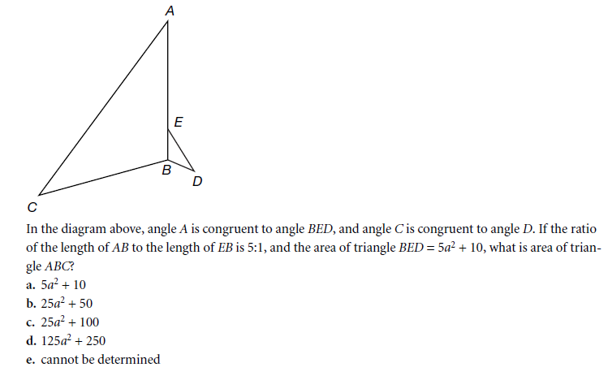
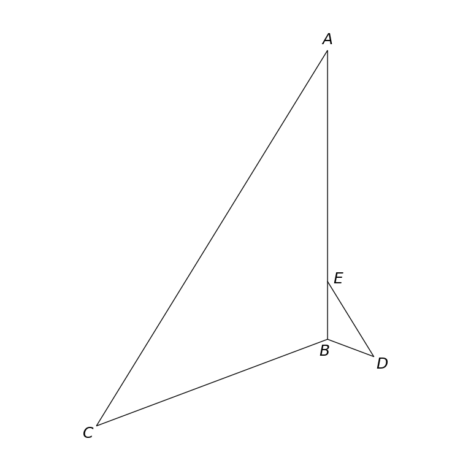

# MathVista 315 · 平面几何

[返回总目录](../../README.md) · [上一题 310](../310/README.md) · [下一题 316](../316/README.md)

状态：**待用户审核**。尚未收入正式题库。

## 当前待审核题目

In the diagram above, angle A is congruent to angle BED, and angle C is congruent to angle D. If the ratio of the length of AB to the length of EB is 5:1, and the area of the triangle BED is 5*a^2 + 10, what is the area of triangle ABC?

选项：A. 5*a^2 + 10；B. 25*a^2 + 50；C. 25*a^2 + 100；D. 125*a^2 + 250；E. cannot be determined

当前答案：125*a^2 + 250

## 原图与重绘

| 原图 | 协议重绘 |
|---|---|
|  |  |

点击图片可放大。

## 原题记录

来源：MathVista testmini / GEOS

原题：In the diagram above, angle A is congruent to angle BED, and angle C is congruent to angle D. If the ratio of the length of AB to the length of EB is 5:1, and the area of the triangle BED is 5*a^2 + 10, what is the area of triangle ABC?

原官方答案：125*a^2 + 250

## 注意事项

- Source includes printed question and choices beneath the diagram; retained only in metadata. Display coordinates normalize EB to1, preserving the given5:1 ratio without displaying new lengths.

## 文件与反馈

[冻结场景](scene.json) · [重绘脚本](redraw.py) · [核验报告](redraw_report.json)

[完整来源记录](source_metadata.json)

可在草稿 PR 的 Conversation 留言“MathVista 315：通过 / 需要修改，具体是……”，也可以直接告诉 dot。改编题请明确是否接受改编。点赞或 GitHub 的通用 Approve 不自动代替逐题通过记录。

[来源与许可](../../ATTRIBUTION.md)
