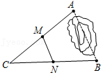
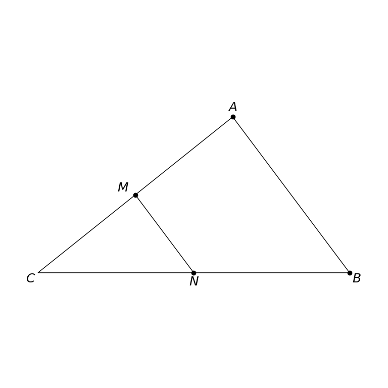

# MathVista 322 · 平面几何

[返回总目录](../../README.md) · [上一题 320](../320/README.md) · [下一题 333](../333/README.md)

状态：**待用户审核**。尚未收入正式题库。

## 当前待审核题目

如图，A，B两点被池塘隔开，在AB外选一点C，使点C能直接到达点A和点B，连接AC和BC，并分别找出AC和BC的中点M，N．如果测得MN＝20m，那么A，B两点的距离是（）

选项：A. 10m；B. 20m；C. 35m；D. 40m

当前答案：40m

## 原图与重绘

| 原图 | 协议重绘 |
|---|---|
|  |  |

点击图片可放大。

## 原题记录

来源：MathVista testmini / GeoQA+

原题：如图，A，B两点被池塘隔开，在AB外选一点C，使点C能直接到达点A和点B，连接AC和BC，并分别找出AC和BC的中点M，N．如果测得MN＝20m，那么A，B两点的距离是（）

原官方答案：40m

## 注意事项

- Decorative pond outline omitted; mathematical triangle and midpoint connection preserved.

## 文件与反馈

[冻结场景](scene.json) · [重绘脚本](redraw.py) · [核验报告](redraw_report.json)

[完整来源记录](source_metadata.json)

可在草稿 PR 的 Conversation 留言“MathVista 322：通过 / 需要修改，具体是……”，也可以直接告诉 dot。改编题请明确是否接受改编。点赞或 GitHub 的通用 Approve 不自动代替逐题通过记录。

[来源与许可](../../ATTRIBUTION.md)
