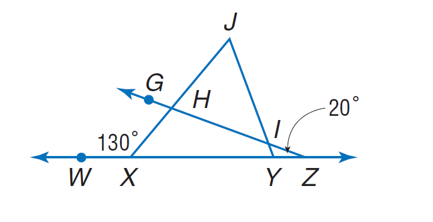
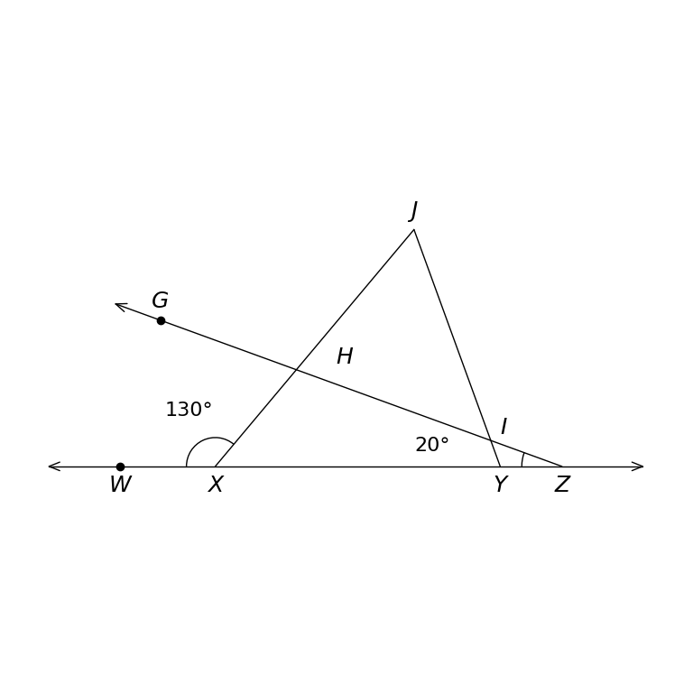

# MathVista 360 · 平面几何

[返回总目录](../../README.md) · [上一题 355](../355/README.md) · [下一题 364](../364/README.md)

状态：**待用户审核**。尚未收入正式题库。

## 当前待审核题目

If $\frac{I J}{X J}=\frac{HJ}{YJ}, m \angle W X J=130$
and $m \angle WZG=20,$ find $m \angle YIZ$

选项：A. 40；B. 50；C. 65；D. 110

当前答案：50

## 原图与重绘

| 原图 | 协议重绘 |
|---|---|
|  |  |

点击图片可放大。

## 原题记录

来源：MathVista testmini / Geometry3K

原题：If $\frac{I J}{X J}=\frac{HJ}{YJ}, m \angle W X J=130$
and $m \angle WZG=20,$ find $m \angle YIZ$

原官方答案：50

## 注意事项

- Original20-degree leader is replaced by a single arc and explicitly bound angle label. Ratio equality is recorded and separately checked in exact_conditions.

## 文件与反馈

[冻结场景](scene.json) · [重绘脚本](redraw.py) · [核验报告](redraw_report.json)

[完整来源记录](source_metadata.json)

可在草稿 PR 的 Conversation 留言“MathVista 360：通过 / 需要修改，具体是……”，也可以直接告诉 dot。改编题请明确是否接受改编。点赞或 GitHub 的通用 Approve 不自动代替逐题通过记录。

[来源与许可](../../ATTRIBUTION.md)
