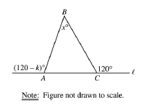
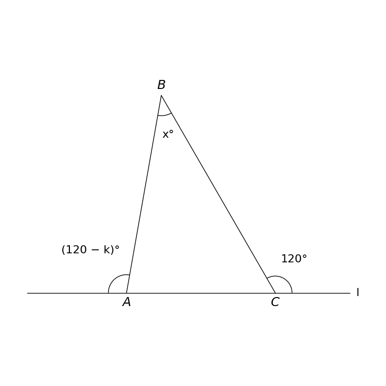

# MathVista 434 · 平面几何

[返回总目录](../../README.md) · [上一题 426](../426/README.md) · [下一题 441](../441/README.md)

状态：**待用户审核**。尚未收入正式题库。

## 当前待审核题目

In the figure above, side AC of triangle ABC is on line l. What is x in terms of k?

选项：A. 60-k；B. k；C. 60+k；D. 120-k；E. 120-2*k

当前答案：60-k

## 原图与重绘

| 原图 | 协议重绘 |
|---|---|
|  |  |

点击图片可放大。

## 原题记录

来源：MathVista testmini / GEOS

原题：In the figure above, side AC of triangle ABC is on line l. What is x in terms of k?

原官方答案：60-k

## 注意事项

- Free display parameter k=20 is not a source given or asserted answer. Source not-to-scale note and printed question are preserved in metadata, not embedded.

## 文件与反馈

[冻结场景](scene.json) · [重绘脚本](redraw.py) · [核验报告](redraw_report.json)

[完整来源记录](source_metadata.json)

可在草稿 PR 的 Conversation 留言“MathVista 434：通过 / 需要修改，具体是……”，也可以直接告诉 dot。改编题请明确是否接受改编。点赞或 GitHub 的通用 Approve 不自动代替逐题通过记录。

[来源与许可](../../ATTRIBUTION.md)
