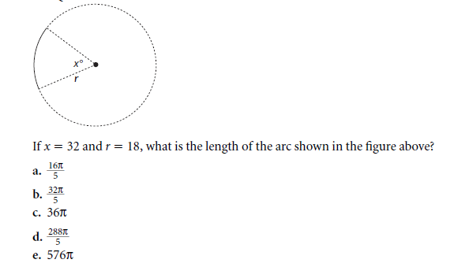
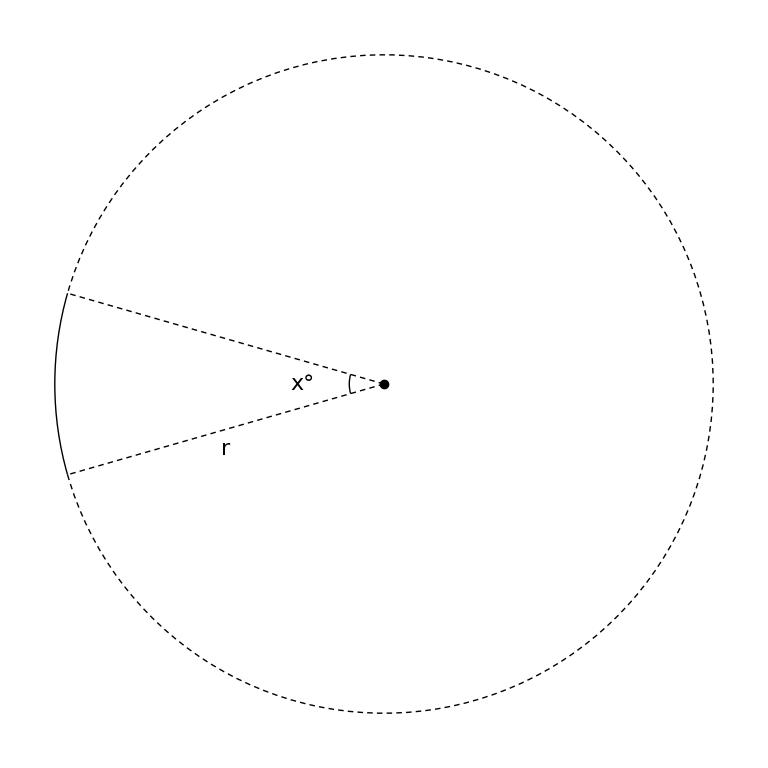

# MathVista 455 · 平面几何

[返回总目录](../../README.md) · [上一题 443](../443/README.md) · [下一题 467](../467/README.md)

状态：**待用户审核**。尚未收入正式题库。

## 当前待审核题目

If x = 32 and r = 18, what is the length of the arc shown in the figure above?

选项：A. 16*\pi/5；B. 32*\pi/5；C. 36*\pi；D. 288*\pi/5；E. 576*\pi

当前答案：16*\pi/5

## 原图与重绘

| 原图 | 协议重绘 |
|---|---|
|  |  |

点击图片可放大。

## 原题记录

来源：MathVista testmini / GEOS

原题：If x = 32 and r = 18, what is the length of the arc shown in the figure above?

原官方答案：16*\pi/5

## 注意事项

- Source dotted contextual circle is normalized to protocol dashed style. Full printed question and answer options excluded. Highlighted solid arc retained; no arc-length answer added.

## 文件与反馈

[冻结场景](scene.json) · [重绘脚本](redraw.py) · [核验报告](redraw_report.json)

[完整来源记录](source_metadata.json)

可在草稿 PR 的 Conversation 留言“MathVista 455：通过 / 需要修改，具体是……”，也可以直接告诉 dot。改编题请明确是否接受改编。点赞或 GitHub 的通用 Approve 不自动代替逐题通过记录。

[来源与许可](../../ATTRIBUTION.md)
