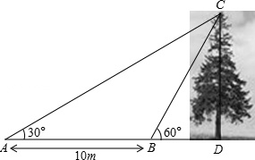
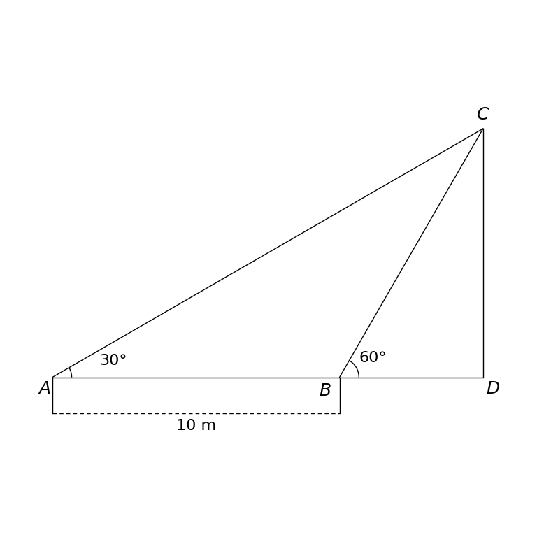

# MathVista 523 · 平面几何

[返回总目录](../../README.md) · [上一题 521](../521/README.md) · [下一题 526](../526/README.md)

状态：**待用户审核**。尚未收入正式题库。

## 当前待审核题目

As shown in the figure, a teaching interest group wants to measure the height of a tree CD. They firstly measured the elevation angle of the tree top C at point A as 30.0, and then proceeded 10.0 along the direction of AD to point B, and the elevation angle of tree top C measured at B is 60.0  (the three points A, B, and D are on the same straight line), then the height of the tree CD is ()

选项：A. 10m；B. 5m；C. 5√{3}m；D. 10√{3}m

当前答案：5√{3}m

## 原图与重绘

| 原图 | 协议重绘 |
|---|---|
|  |  |

点击图片可放大。

## 原题记录

来源：MathVista testmini / UniGeo

原题：As shown in the figure, a teaching interest group wants to measure the height of a tree CD. They firstly measured the elevation angle of the tree top C at point A as 30.0, and then proceeded 10.0 along the direction of AD to point B, and the elevation angle of tree top C measured at B is 60.0  (the three points A, B, and D are on the same straight line), then the height of the tree CD is ()

原官方答案：5√{3}m

## 注意事项

- Photographic tree background omitted as decorative context; segment CD preserves the measured tree height and endpoints.

## 文件与反馈

[冻结场景](scene.json) · [重绘脚本](redraw.py) · [核验报告](redraw_report.json)

[完整来源记录](source_metadata.json)

可在草稿 PR 的 Conversation 留言“MathVista 523：通过 / 需要修改，具体是……”，也可以直接告诉 dot。改编题请明确是否接受改编。点赞或 GitHub 的通用 Approve 不自动代替逐题通过记录。

[来源与许可](../../ATTRIBUTION.md)
