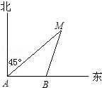
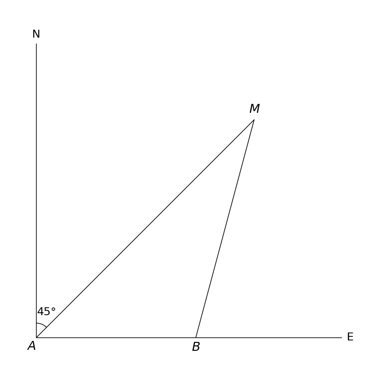

# MathVista 587 · 平面几何

[返回总目录](../../README.md) · [上一题 586](../586/README.md) · [下一题 599](../599/README.md)

状态：**待用户审核**。尚未收入正式题库。

## 当前待审核题目

At 9.0 in the morning, a ship departs from point A and sails in the direction due east at a speed of 40.0 nautical miles per hour, and arrives at point B at 9.0 and 30.0 minutes. As shown in the figure, the island M is measured from A and B. In the direction of 45.0 north by east and 15.0 north by east, then the distance between B and island M is ()

选项：A. 20海里；B. 20√{2}海里；C. 15海里；D. 20海里

当前答案：20√{2}海里

## 原图与重绘

| 原图 | 协议重绘 |
|---|---|
|  |  |

点击图片可放大。

## 原题记录

来源：MathVista testmini / UniGeo

原题：At 9.0 in the morning, a ship departs from point A and sails in the direction due east at a speed of 40.0 nautical miles per hour, and arrives at point B at 9.0 and 30.0 minutes. As shown in the figure, the island M is measured from A and B. In the direction of 45.0 north by east and 15.0 north by east, then the distance between B and island M is ()

原官方答案：20√{2}海里

## 注意事项

- Chinese compass labels 北 and 东 are rendered as N and E to retain meaning under the required DejaVu Sans font; source metadata preserves originals.

## 文件与反馈

[冻结场景](scene.json) · [重绘脚本](redraw.py) · [核验报告](redraw_report.json)

[完整来源记录](source_metadata.json)

可在草稿 PR 的 Conversation 留言“MathVista 587：通过 / 需要修改，具体是……”，也可以直接告诉 dot。改编题请明确是否接受改编。点赞或 GitHub 的通用 Approve 不自动代替逐题通过记录。

[来源与许可](../../ATTRIBUTION.md)
