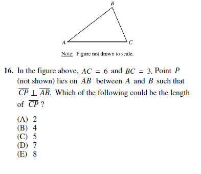
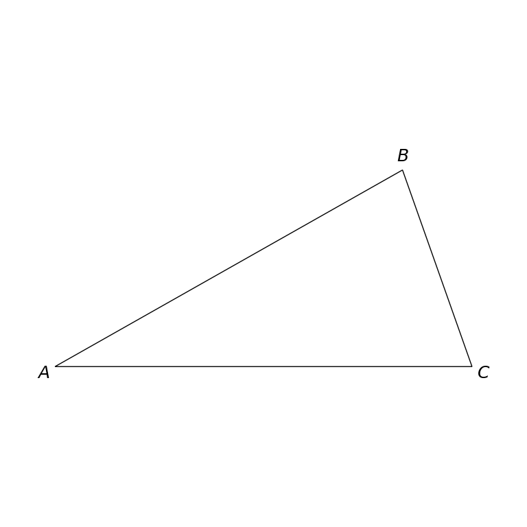

# MathVista 599 · 平面几何

[返回总目录](../../README.md) · [上一题 586](../586/README.md) · [下一题 602](../602/README.md)

状态：**待用户审核**。尚未收入正式题库。

## 当前待审核题目

In the figure above, AC = 6 and BC = 3. Point P lies on line AB between A and B such that line CP is perpendicular to line AB. Which of the following could be the length of line CP?

选项：A. 2；B. 4；C. 5；D. 7；E. 8

当前答案：2

## 原图与重绘

| 原图 | 协议重绘 |
|---|---|
|  |  |

点击图片可放大。

## 原题记录

来源：MathVista testmini / GEOS

原题：In the figure above, AC = 6 and BC = 3. Point P lies on line AB between A and B such that line CP is perpendicular to line AB. Which of the following could be the length of line CP?

原官方答案：2

## 文件与反馈

[冻结场景](scene.json) · [重绘脚本](redraw.py) · [核验报告](redraw_report.json)

[完整来源记录](source_metadata.json)

可在草稿 PR 的 Conversation 留言“MathVista 599：通过 / 需要修改，具体是……”，也可以直接告诉 dot。改编题请明确是否接受改编。点赞或 GitHub 的通用 Approve 不自动代替逐题通过记录。

[来源与许可](../../ATTRIBUTION.md)
