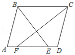
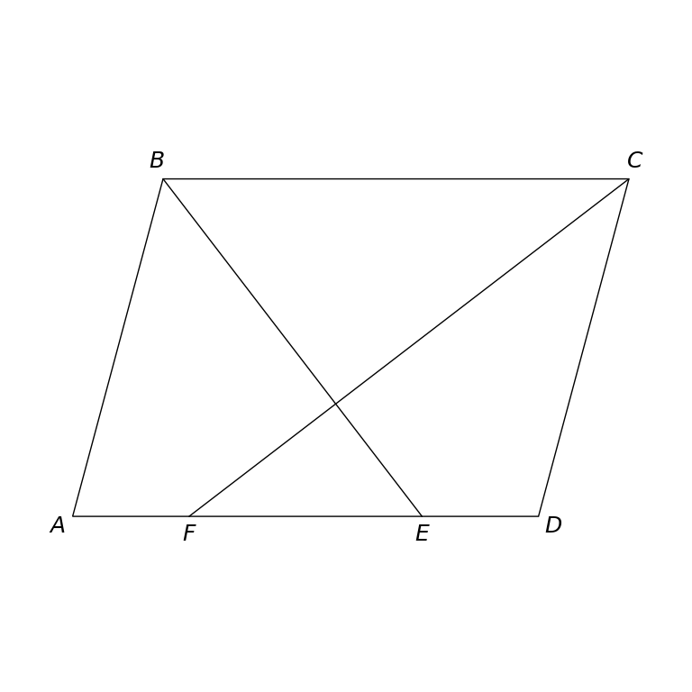

# MathVista 628 · 平面几何

[返回总目录](../../README.md) · [上一题 622](../622/README.md) · [下一题 630](../630/README.md)

状态：**待用户审核**。尚未收入正式题库。

## 当前待审核题目

如图，在ABCD中，∠ABC的平分线交AD于点E，∠BCD的平分线交AD于点F，若AB＝3，AD＝4，则EF的长是（）

选项：A. 1；B. 2；C. 2.5；D. 3

当前答案：2

## 原图与重绘

| 原图 | 协议重绘 |
|---|---|
|  |  |

点击图片可放大。

## 原题记录

来源：MathVista testmini / GeoQA+

原题：如图，在ABCD中，∠ABC的平分线交AD于点E，∠BCD的平分线交AD于点F，若AB＝3，AD＝4，则EF的长是（）

原官方答案：2

## 文件与反馈

[冻结场景](scene.json) · [重绘脚本](redraw.py) · [核验报告](redraw_report.json)

[完整来源记录](source_metadata.json)

可在草稿 PR 的 Conversation 留言“MathVista 628：通过 / 需要修改，具体是……”，也可以直接告诉 dot。改编题请明确是否接受改编。点赞或 GitHub 的通用 Approve 不自动代替逐题通过记录。

[来源与许可](../../ATTRIBUTION.md)
