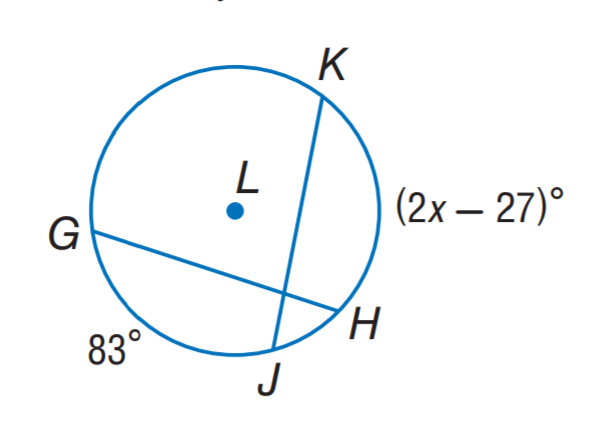
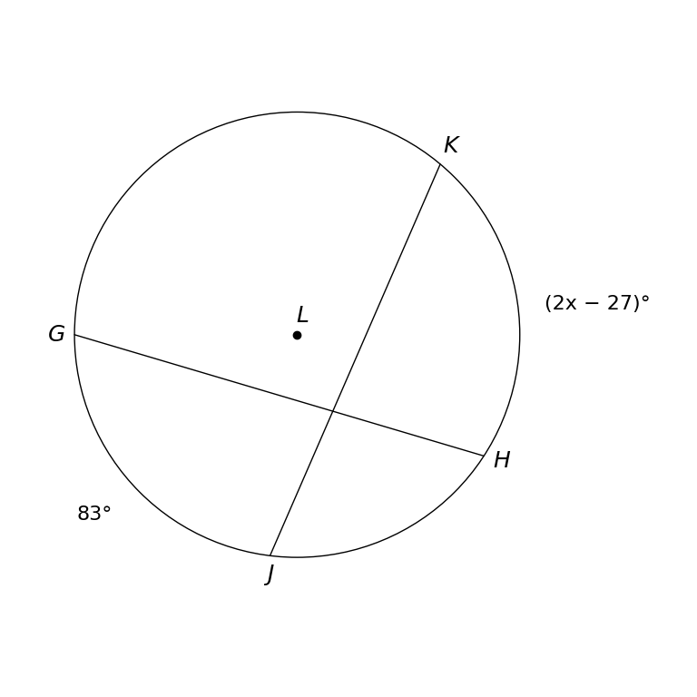

# MathVista 684 · 平面几何

[返回总目录](../../README.md) · [上一题 679](../679/README.md) · [下一题 690](../690/README.md)

状态：**待用户审核（改编题）**。尚未收入正式题库。

## 当前待审核题目

In circle $L$, $\overline{GH}\cong\overline{KJ}$. Point $J$ lies on the minor arc $GH$, and point $H$ lies on the minor arc $KJ$, as shown. The minor arcs $GJ$ and $KH$ measure $83^\circ$ and $(2x-27)^\circ$, respectively. Find $x$.

选项：A. 27；B. 54；C. 55；D. 83

当前答案：55

## 原图与重绘

| 原图 | 协议重绘 |
|---|---|
|  |  |

点击图片可放大。

## 原题记录

来源：MathVista testmini / Geometry3K

原题：$\overline{CH} \cong \overline{KJ}$. Find $x$.

原官方答案：55

## 改编说明

- {"field": "question", "change": "Replace the nonexistent chord CH with GH.", "rationale": "The source image labels the left chord endpoint G and has no point C; preserve all visible diagram names."}
- {"field": "question", "change": "Explicitly specify J on minor arc GH and H on minor arc KJ; restate the two existing arc labels in words.", "rationale": "This makes the intended minor-arc placement shown by the diagram explicit, preventing the alternate equal-chord branch. It changes no diagram marks, numerical labels, choices or protocol settings."}

Correct the nonexistent endpoint C to visible G and make the intended minor-arc placement explicit so the geometry and answer are unambiguous. Preserve the original image, metadata, all numerical labels, all options and all protocol settings.

[完整改编记录、解题与独立检查](adapted_question.json)

## 文件与反馈

[冻结场景](scene.json) · [重绘脚本](redraw.py) · [核验报告](redraw_report.json)

[完整来源记录](source_metadata.json)

可在草稿 PR 的 Conversation 留言“MathVista 684：通过 / 需要修改，具体是……”，也可以直接告诉 dot。改编题请明确是否接受改编。点赞或 GitHub 的通用 Approve 不自动代替逐题通过记录。

[来源与许可](../../ATTRIBUTION.md)
