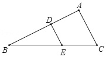
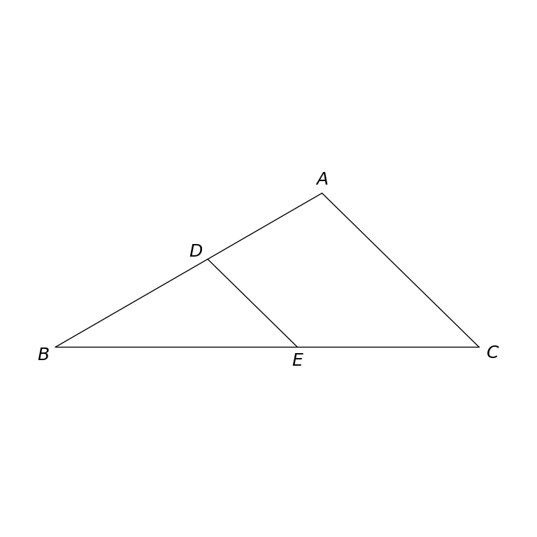

# MathVista 749 · 平面几何

[返回总目录](../../README.md) · [上一题 748](../748/README.md) · [下一题 757](../757/README.md)

状态：**待用户审核（改编题）**。尚未收入正式题库。

## 当前待审核题目

In triangle ABC, D lies on AB and E lies on BC, with DE ∥ AC. If AB = 7 cm, AC = 5 cm and AD = 3 cm, find DE.

选项：A. \frac{15}{4}cm；B. \frac{20}{3}cm；C. \frac{15}{7}cm；D. \frac{20}{7}cm

当前答案：\frac{20}{7}cm

## 原图与重绘

| 原图 | 协议重绘 |
|---|---|
|  |  |

点击图片可放大。

## 原题记录

来源：MathVista testmini / UniGeo

原题：As shown in the figure, in △ABC, DE ∥ BC, if AB = 7.0, AC = 5.0, AD = 3.0, then DE = ()

原官方答案：\frac{20}{7}cm

## 改编说明

- {"field": "parallel condition", "original": "DE ∥ BC", "replacement": "DE ∥ AC", "rationale": "E lies on BC, so the original nondegenerate parallel condition was impossible. The replacement agrees with the preserved diagram."}
- {"field": "point incidence and units", "original": "Implicit in the figure/options", "replacement": "D on AB, E on BC; lengths in cm", "rationale": "Makes the similarity correspondence and units explicit."}

[完整改编记录、解题与独立检查](adapted_question.json)

## 文件与反馈

[冻结场景](scene.json) · [重绘脚本](redraw.py) · [核验报告](redraw_report.json)

[完整来源记录](source_metadata.json)

可在草稿 PR 的 Conversation 留言“MathVista 749：通过 / 需要修改，具体是……”，也可以直接告诉 dot。改编题请明确是否接受改编。点赞或 GitHub 的通用 Approve 不自动代替逐题通过记录。

[来源与许可](../../ATTRIBUTION.md)
