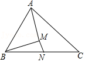
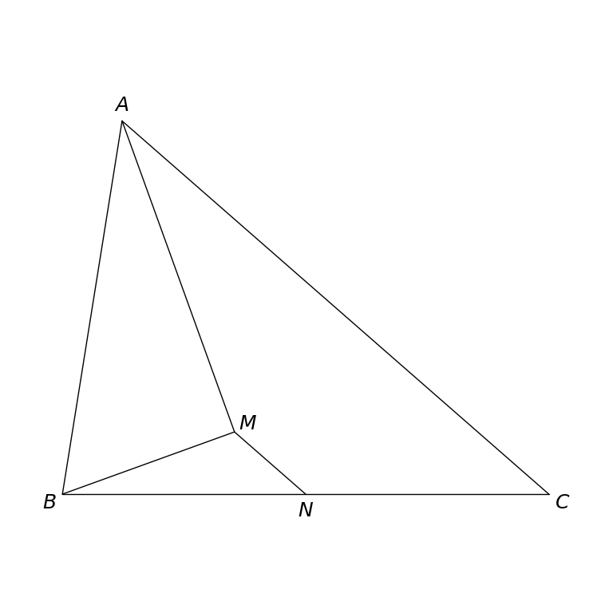

# MathVista 790 · 平面几何

[返回总目录](../../README.md) · [上一题 786](../786/README.md) · [下一题 798](../798/README.md)

状态：**待用户审核（改编题）**。尚未收入正式题库。

## 当前待审核题目

如图，在△ABC中，AC＞AB，N是BC边上的中点，AM平分∠BAC，BM⊥AM于点M，连接MN。若AB＝8，MN＝2，则AC的长为（）

选项：A. 10；B. 11；C. 12；D. 13

当前答案：12

## 原图与重绘

| 原图 | 协议重绘 |
|---|---|
|  |  |

点击图片可放大。

## 原题记录

来源：MathVista testmini / GeoQA+

原题：如图，△ABC中，N是BC边上的中点，AM平分∠BAC，BM⊥AM于点M，若AB＝8，MN＝2．则AC的长为（）

原官方答案：12

## 改编说明

- {"field": "branch condition", "original": "No explicit comparison of AC and AB", "replacement": "AC＞AB", "rationale": "The other configuration gives AC=4. This short condition selects the intended configuration and makes the answer unique."}
- {"field": "connection wording", "original": "MN shown only in the diagram", "replacement": "连接MN", "rationale": "Clarifies that AM and MN are connected segments, without asserting A, M and N are collinear."}

[完整改编记录、解题与独立检查](adapted_question.json)

## 文件与反馈

[冻结场景](scene.json) · [重绘脚本](redraw.py) · [核验报告](redraw_report.json)

[完整来源记录](source_metadata.json)

可在草稿 PR 的 Conversation 留言“MathVista 790：通过 / 需要修改，具体是……”，也可以直接告诉 dot。改编题请明确是否接受改编。点赞或 GitHub 的通用 Approve 不自动代替逐题通过记录。

[来源与许可](../../ATTRIBUTION.md)
