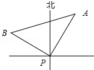
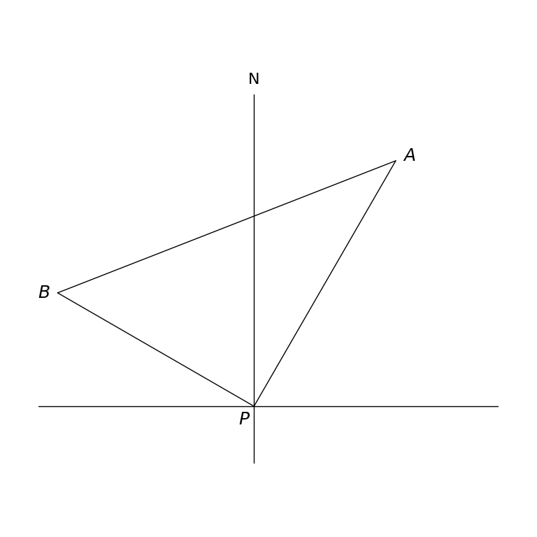

# MathVista 842 · 平面几何

[返回总目录](../../README.md) · [上一题 822](../822/README.md) · [下一题 853](../853/README.md)

状态：**待用户审核（改编题）**。尚未收入正式题库。

## 当前待审核题目

In the diagram, N denotes north. Lighthouse A is 50 nautical miles from point P, on a bearing 30° east of north. A passenger ship travels from P at 60 nautical miles per hour for 2/3 hour on a bearing 60° west of north, reaching B. Find tan∠BAP.

选项：A. \frac{4}{5}；B. \frac{6}{5}；C. \frac{\sqrt{5}}{5}；D. \frac{2\sqrt{5}}{5}

当前答案：\frac{4}{5}

## 原图与重绘

| 原图 | 协议重绘 |
|---|---|
|  |  |

点击图片可放大。

## 原题记录

来源：MathVista testmini / UniGeo

原题：At a certain moment, there is a passenger ship at sea point P, and lighthouse A is measured in the direction 30.0 north by east of P, and is 50.0 nautical miles away. The passenger ship sails at the speed of 60.0 nautical mile/hour in the direction of 60.0 from north by west for $\frac{2.0}{3.0}$hours to reach point B, then tan∠BAP = ()

原官方答案：\frac{4}{5}

## 改编说明

- {"field": "diagram cardinal label", "original": "北", "replacement": "N", "rationale": "The protocol requires DejaVu Sans. Replacing the unsupported glyph with N preserves the direction using only the required font."}
- {"field": "direction notation and label definition", "original": "Ambiguous translated phrasing north by east/from north by west; 北 not defined in English", "replacement": "N means north; bearings 30° east of north and 60° west of north", "rationale": "Makes the intended bearing convention explicit without changing the frozen geometry or given magnitudes."}
- {"field": "choice radical notation", "original": "Unicode square-root symbols inside TeX fractions", "replacement": "Standard \\sqrt{5} notation", "rationale": "Equivalent choice values with valid mathematical notation."}

[完整改编记录、解题与独立检查](adapted_question.json)

## 文件与反馈

[冻结场景](scene.json) · [重绘脚本](redraw.py) · [核验报告](redraw_report.json)

[完整来源记录](source_metadata.json)

可在草稿 PR 的 Conversation 留言“MathVista 842：通过 / 需要修改，具体是……”，也可以直接告诉 dot。改编题请明确是否接受改编。点赞或 GitHub 的通用 Approve 不自动代替逐题通过记录。

[来源与许可](../../ATTRIBUTION.md)
