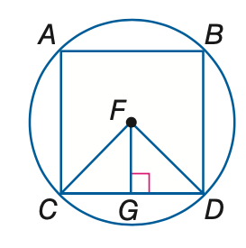
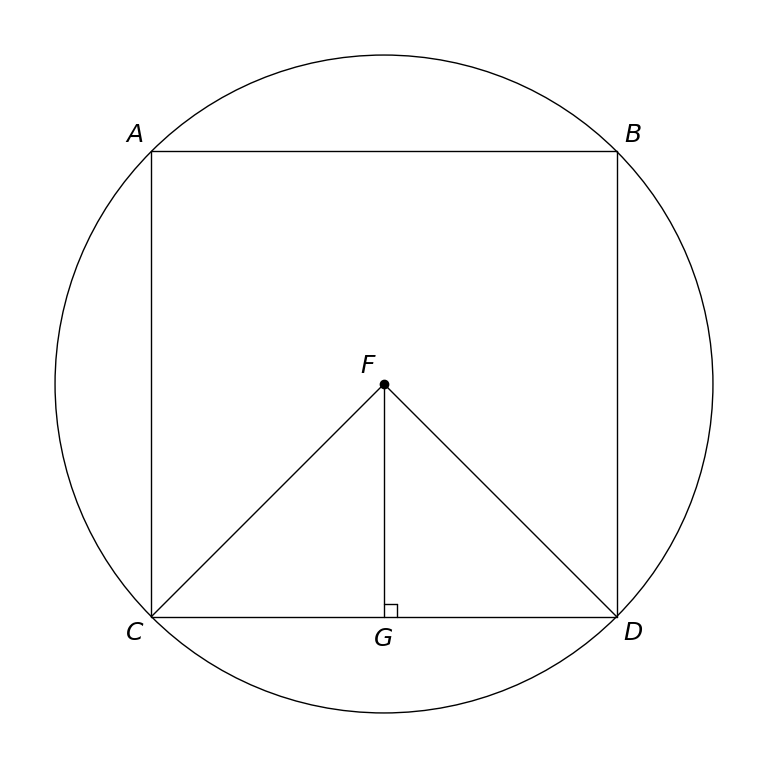

# MathVista 876 · 平面几何

[返回总目录](../../README.md) · [上一题 866](../866/README.md) · [下一题 878](../878/README.md)

状态：**待用户审核（改编题）**。尚未收入正式题库。

## 当前待审核题目

In the figure, square ABDC is inscribed in a circle with center F. Find the measure of the central angle ∠CFD, in degrees.

选项：A. 45；B. 60；C. 90；D. 180

当前答案：90

## 原图与重绘

| 原图 | 协议重绘 |
|---|---|
|  |  |

点击图片可放大。

## 原题记录

来源：MathVista testmini / Geometry3K

原题：In the figure, square $ABDC$ is inscribed in $\odot K$. Find the measure of a central angle.

原官方答案：90

## 改编说明

- {"field": "circle center", "original": "K", "replacement": "F", "rationale": "The source image labels the center F. Naming F consistently removes the question/diagram mismatch."}
- {"field": "target", "original": "a central angle", "replacement": "∠CFD", "rationale": "C and D are adjacent square vertices, making the intended one-side central angle explicit."}

[完整改编记录、解题与独立检查](adapted_question.json)

## 文件与反馈

[冻结场景](scene.json) · [重绘脚本](redraw.py) · [核验报告](redraw_report.json)

[完整来源记录](source_metadata.json)

可在草稿 PR 的 Conversation 留言“MathVista 876：通过 / 需要修改，具体是……”，也可以直接告诉 dot。改编题请明确是否接受改编。点赞或 GitHub 的通用 Approve 不自动代替逐题通过记录。

[来源与许可](../../ATTRIBUTION.md)
