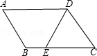
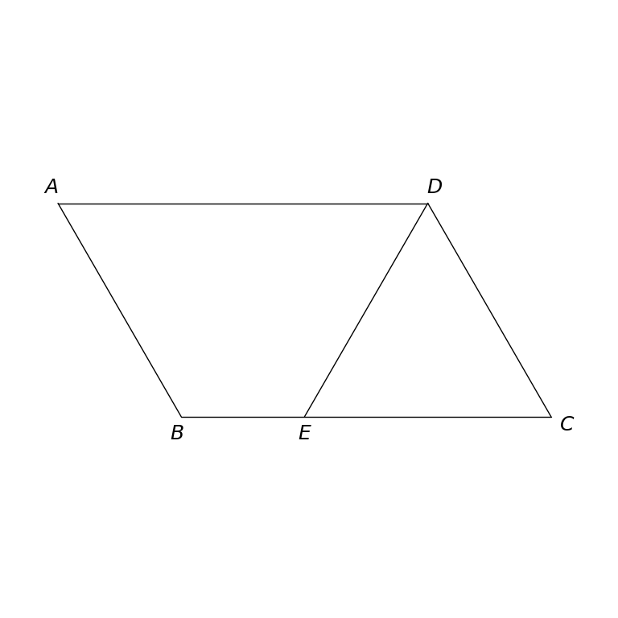

# MathVista 935 · 平面几何

[返回总目录](../../README.md) · [上一题 931](../931/README.md) · [下一题 938](../938/README.md)

状态：**待用户审核（改编题）**。尚未收入正式题库。

## 当前待审核题目

如图，在平行四边形ABCD中，AD＝6，AB＝4，DE平分∠ADC交BC于点E，则BE的长是（）

选项：A. 2；B. 3；C. 4；D. 5

当前答案：2

## 原图与重绘

| 原图 | 协议重绘 |
|---|---|
|  |  |

点击图片可放大。

## 原题记录

来源：MathVista testmini / GeoQA+

原题：如图，在ABCD中，AD＝6，AB＝4，DE平分∠ADC交BC于点E，则BE的长是（）

原官方答案：2

## 改编说明

- {"field": "quadrilateral type", "original": "在ABCD中", "replacement": "在平行四边形ABCD中", "rationale": "The missing type leaves BE underdetermined. A parallelogram is the minimal condition consistent with the intended source layout; both opposite-side parallel relations are now imposed exactly."}
- {"field": "frozen display coordinate of C", "original": "C=(8.4,0)", "replacement": "C=(8,0)", "rationale": "With A=(0,√12), B=(2,0), D=(6,√12), this makes ABCD an exact parallelogram. E is reconstructed on its angle bisector, becoming E=(4,0)."}

[完整改编记录、解题与独立检查](adapted_question.json)

## 文件与反馈

[冻结场景](scene.json) · [重绘脚本](redraw.py) · [核验报告](redraw_report.json)

[完整来源记录](source_metadata.json)

可在草稿 PR 的 Conversation 留言“MathVista 935：通过 / 需要修改，具体是……”，也可以直接告诉 dot。改编题请明确是否接受改编。点赞或 GitHub 的通用 Approve 不自动代替逐题通过记录。

[来源与许可](../../ATTRIBUTION.md)
