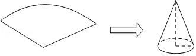
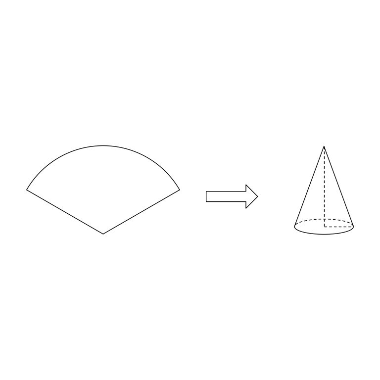

# MathVista 33 · 立体几何

[返回总目录](../../README.md) · [上一题 30](../../batch1/30/README.md) · [下一题 48](../../batch1/48/README.md)

状态：**待用户审核**。尚未收入正式题库。

## 当前待审核题目

Use a sector paper sheet with a central angle of 120.0 and a radius of 6.0 to roll into a conical bottomless paper cap (as shown in the picture), then the bottom perimeter of the paper cap is ()

选项：A. 2πcm；B. 3πcm；C. 4πcm；D. 5πcm

当前答案：4πcm

## 原图与重绘

| 原图 | 协议重绘 |
|---|---|
|  |  |

点击图片可放大。

## 原题记录

来源：MathVista testmini / UniGeo

原题：Use a sector paper sheet with a central angle of 120.0 and a radius of 6.0 to roll into a conical bottomless paper cap (as shown in the picture), then the bottom perimeter of the paper cap is ()

原官方答案：4πcm

## 注意事项

- Source thumbnail is schematic. Exact 120-degree sector and rolled cone derived from sector radius6 and no overlap; silhouette/hidden intervals calculated for frozen 15-degree orthographic elevation. Sector oriented in screen plane; cone upright in world. Relative panel placement and arrow shape are display choices.
- No numeric labels exist in original figure; angle120, radius6 and derived base radius2 are model checks only, not added diagram labels.

## 文件与反馈

[冻结场景](scene.json) · [重绘脚本](redraw.py) · [核验报告](redraw_report.json)

[完整来源记录](source.json)

可在草稿 PR 的 Conversation 留言“MathVista 33：通过 / 需要修改，具体是……”，也可以直接告诉 dot。改编题请明确是否接受改编。点赞或 GitHub 的通用 Approve 不自动代替逐题通过记录。

[来源与许可](../../ATTRIBUTION.md)
