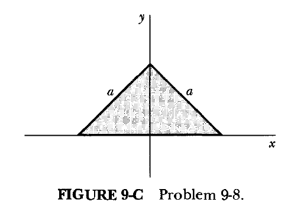
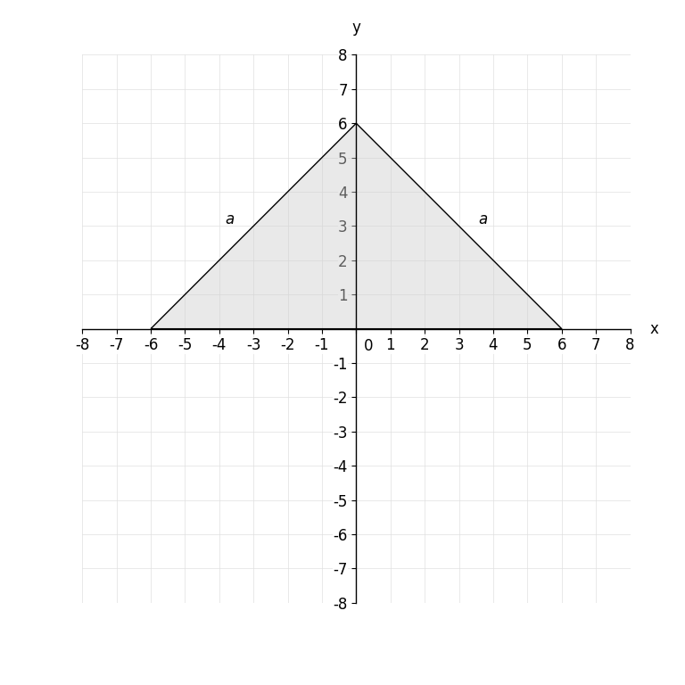

# MathVista 512 · 解析几何

[返回总目录](../../README.md) · [上一题 510](../../batch3/510/README.md) · [下一题 521](../../batch3/521/README.md)

状态：**待用户审核（改编题）**。尚未收入正式题库。

## 当前待审核题目

The figure shows an isosceles right triangle of uniform areal density. Its equal legs have length a = 6√2 in the coordinate axes' length units. Its hypotenuse lies on the x-axis and its right-angle vertex lies on the positive y-axis. What is the y-coordinate of its center of mass? Give your answer to two decimal places.

当前答案：2.00

## 原图与重绘

| 原图 | 协议重绘 |
|---|---|
|  |  |

点击图片可放大。

## 原题记录

来源：MathVista testmini / SciBench

原题：What is the y coordinate of the center of mass of the isosceles right triangle of uniform areal density shown in Figure 9-C?

原官方答案：0.24

## 改编说明

- {"field": "question", "change": "Add explicit a=6√2 and axis incidence conditions already depicted.", "rationale": "Original omitted numerical length a; scale cannot be invented on mandatory numeric [-8,8]² axes. This value yields a legible triangle wholly inside that window."}
- {"field": "answer", "from": "0.24", "to": "2.00", "rationale": "Recomputed for explicitly supplied length; source answer never reused as a coordinate constraint."}

[完整改编记录、解题与独立检查](adapted_question.json)

## 注意事项

- Adapted question explicitly supplies a=6√2 to resolve missing source scale while obeying the mandatory fixed integer axes. Source official answer0.24 remains separately preserved; adapted answer is2.00.
- Triangle size and origin placement are exact consequences of the adapted statement, not unannounced extra givens. Semantic fill denotes the source uniform lamina.

## 文件与反馈

[冻结场景](scene.json) · [重绘脚本](redraw.py) · [核验报告](redraw_report.json)

[完整来源记录](source.json)

可在草稿 PR 的 Conversation 留言“MathVista 512：通过 / 需要修改，具体是……”，也可以直接告诉 dot。改编题请明确是否接受改编。点赞或 GitHub 的通用 Approve 不自动代替逐题通过记录。

[来源与许可](../../ATTRIBUTION.md)
