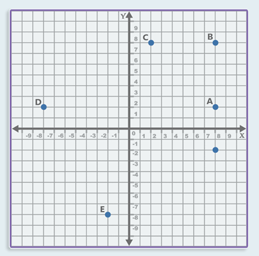
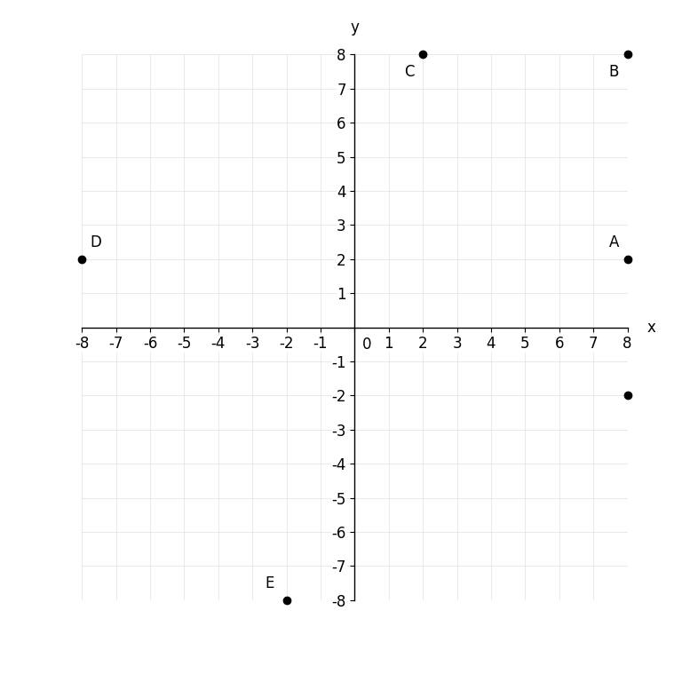

# MathVista 706 · 解析几何

[返回总目录](../../README.md) · [上一题 700](../../batch3/700/README.md) · [下一题 707](../../batch3/707/README.md)

状态：**待用户审核**。尚未收入正式题库。

## 当前待审核题目

Find the image of the dot (8,-2) under a clockwise rotation by 270° about the origin."

选项：A. A；B. B；C. C；D. D；E. E

当前答案：C

## 原图与重绘

| 原图 | 协议重绘 |
|---|---|
|  |  |

点击图片可放大。

## 原题记录

来源：MathVista testmini / IQTest

原题：Find the image of the dot (8,-2) under a clockwise rotation by 270° about the origin."

原官方答案：C

## 注意事项

- Source axes extend to about ±11. Protocol fixed window ±8 puts five points on boundary. Markers rendered unclipped and labels placed inward; coordinates unchanged.

## 文件与反馈

[冻结场景](scene.json) · [重绘脚本](redraw.py) · [核验报告](redraw_report.json)

[完整来源记录](source.json)

可在草稿 PR 的 Conversation 留言“MathVista 706：通过 / 需要修改，具体是……”，也可以直接告诉 dot。改编题请明确是否接受改编。点赞或 GitHub 的通用 Approve 不自动代替逐题通过记录。

[来源与许可](../../ATTRIBUTION.md)
